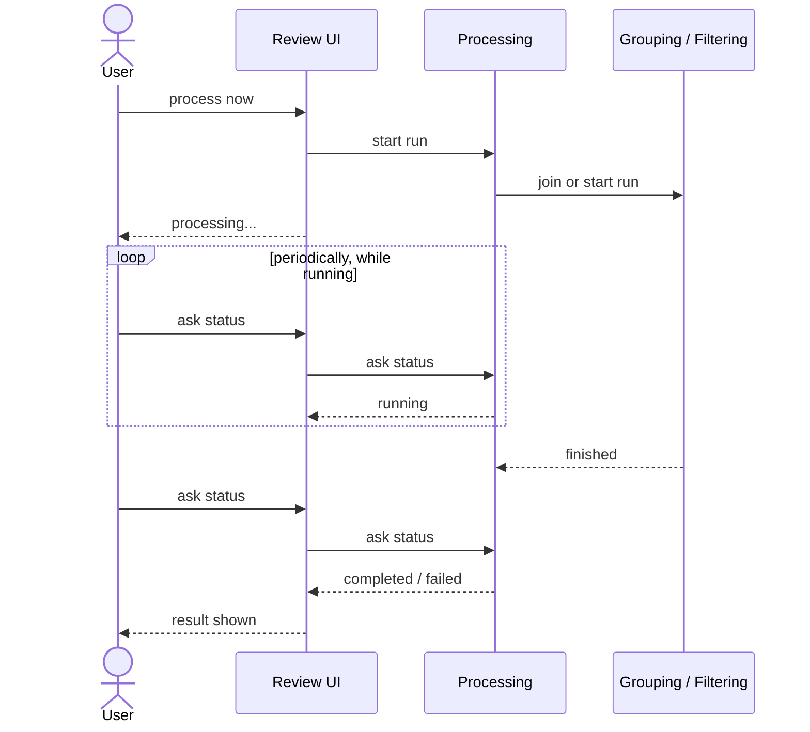
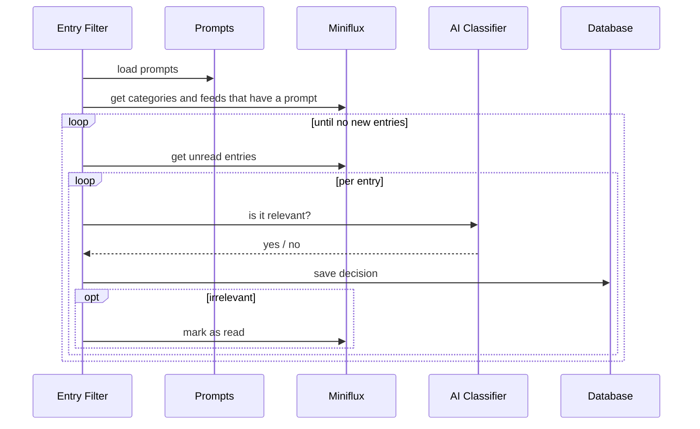
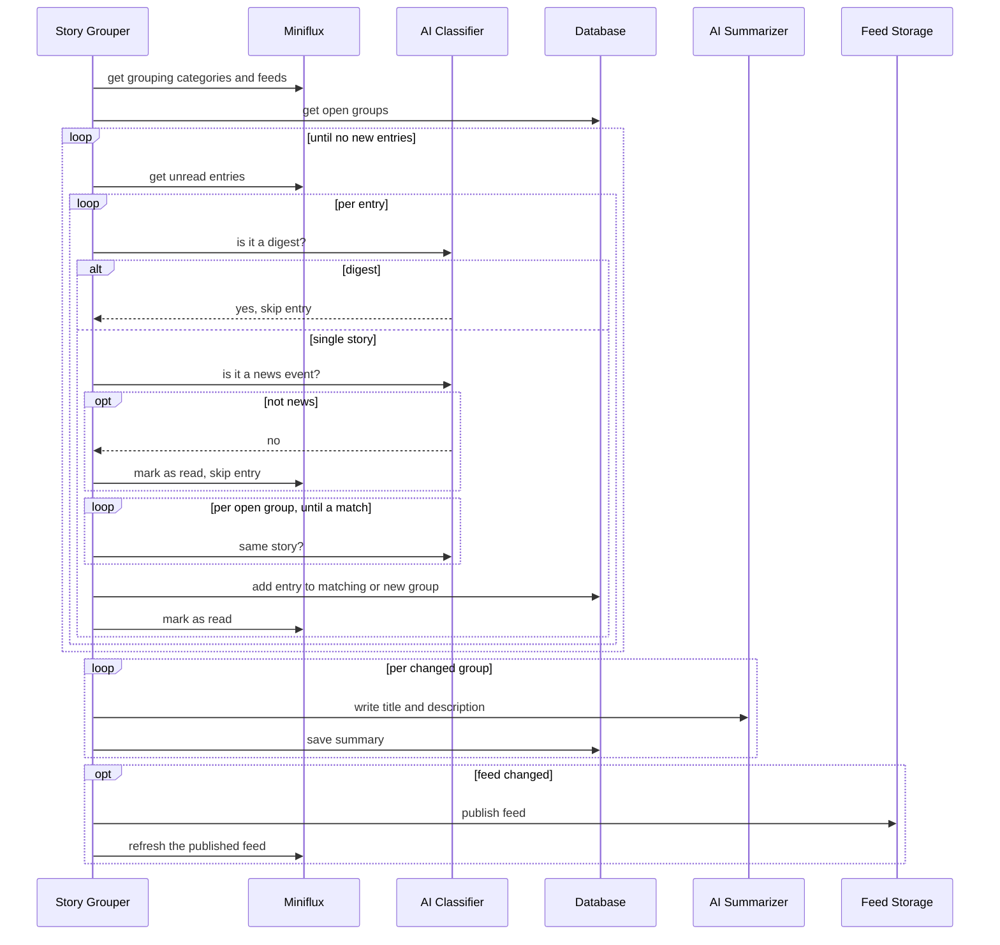
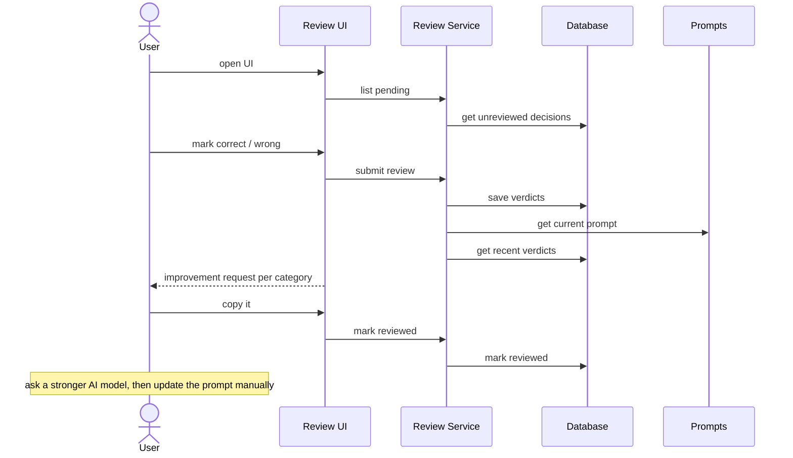

# Introduction and Goals

Miniflux AI extensions allows to reduces the noise in an RSS feed by filtering out irrelevant articles and to have multiple perspectives on the same event by grouping similar articles from different sources. 

## Requirements Overview

1. Filtering of Miniflux feeds accordingly to the criterias described by a user in markdown format
2. Grouping

## Quality Goals

## Stakeholders

| Role/Name    | Contact         | Expectations        |
|--------------|-----------------|---------------------|
| *\<Role-1\>* | *\<Contact-1\>* | *\<Expectation-1\>* |
| *\<Role-2\>* | *\<Contact-2\>* | *\<Expectation-2\>* |

# Architecture Constraints

# Context and Scope

## Business Context

**\<Diagram or Table\>**

**\<optionally: Explanation of external domain interfaces\>**

## Technical Context

**\<Diagram or Table\>**

**\<optionally: Explanation of technical interfaces\>**

**\<Mapping Input/Output to Channels\>**

# Solution Strategy

# Building Block View

## Whitebox Overall System

***\<Overview Diagram\>***

Motivation  
*\<text explanation\>*

Contained Building Blocks  
*\<Description of contained building block (black boxes)\>*

Important Interfaces  
*\<Description of important interfaces\>*

### \<Name black box 1\>

*\<Purpose/Responsibility\>*

*\<Interface(s)\>*

*\<(Optional) Quality/Performance Characteristics\>*

*\<(Optional) Directory/File Location\>*

*\<(Optional) Fulfilled Requirements\>*

*\<(optional) Open Issues/Problems/Risks\>*

### \<Name black box 2\>

*\<black box template\>*

### \<Name black box n\>

*\<black box template\>*

### \<Name interface 1\>

…​

### \<Name interface m\>

## Level 2

### White Box *\<building block 1\>*

*\<white box template\>*

### White Box *\<building block 2\>*

*\<white box template\>*

…​

### White Box *\<building block m\>*

*\<white box template\>*

## Level 3

### White Box \<\_building block x.1\_\>

*\<white box template\>*

### White Box \<\_building block x.2\_\>

*\<white box template\>*

### White Box \<\_building block y.1\_\>

*\<white box template\>*

# Runtime View

Nothing runs on startup or on a schedule. Every processing run is started by the user from the review UI.

## Triggering a Processing Run

- Grouping and filtering run in parallel by default, or one after another when configured, so the local AI keeps only one model loaded at a time.
- Pressing the button again during a run joins that run instead of starting another one.

## Filtering Entries

- Each category is matched to the user's prompt written for it.
- Entries are fetched repeatedly, because Miniflux returns only a limited number at a time.
- If the classifier fails or gives an unclear answer, the entry stays unread and is retried on the next run.
- An unsure answer (probability of relevance between 0.3 and 0.5) leaves the entry unread, so only a confident "no" hides an entry.
- A decision that changes on a later run goes back to the review queue.

## Grouping Stories and Publishing the Feed

- A group stays open for new entries, and stays in the feed, only for a limited time after its first entry.
- Summaries are written after all grouping decisions, so the two AI models are not needed at the same time.
- Miniflux subscribes to the published feed like any other feed, so grouped stories are filtered like regular entries.
- A failing entry is retried on the next run. If Miniflux becomes unavailable mid-run, the groups made so far are still summarized and published, and the run is reported as failed.

## Reviewing Decisions and Improving a Prompt

- Subcategories are reviewed together with their parent category, so one request improves one prompt.
- The user can discard older unreviewed decisions to keep the queue short. Discarded decisions are not used to improve prompts.
- The next run uses the updated prompt.

# Deployment View

## Infrastructure Level 1

***\<Overview Diagram\>***

Motivation  
*\<explanation in text form\>*

Quality and/or Performance Features  
*\<explanation in text form\>*

Mapping of Building Blocks to Infrastructure  
*\<description of the mapping\>*

## Infrastructure Level 2

### *\<Infrastructure Element 1\>*

*\<diagram + explanation\>*

### *\<Infrastructure Element 2\>*

*\<diagram + explanation\>*

…​

### *\<Infrastructure Element n\>*

*\<diagram + explanation\>*

# Cross-cutting Concepts

## *\<Concept 1\>*

*\<explanation\>*

## *\<Concept 2\>*

*\<explanation\>*

…​

## *\<Concept n\>*

*\<explanation\>*

# Architecture Decisions

# Quality Requirements

## Quality Requirements Overview

## Quality Scenarios

# Risks and Technical Debts

# Glossary

| Term         | Definition         |
|--------------|--------------------|
| *\<Term-1\>* | *\<definition-1\>* |
| *\<Term-2\>* | *\<definition-2\>* |

